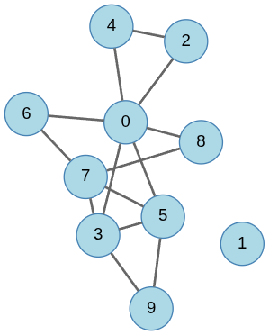

# Relatório — Projeto de Grafos: Circuito de Euler

**Disciplina:** Estruturas Discretas  
**Período:** 2026.2  
**Aluna:** Mayara Ramos Damazio
**Matrícula:** 2210833


---

## 1. Introdução

O presente trabalho tem como objetivo desenvolver um programa capaz de gerar grafos simples, não direcionados e aleatórios, analisando suas propriedades para identificar a existência de circuitos Eulerianos.

Um **circuito de Euler** é um percurso fechado que utiliza todas as arestas de um grafo exatamente uma vez, retornando ao vértice de origem. Para que um grafo não direcionado possua um circuito Euleriano, todos os seus vértices devem apresentar grau par e todos os vértices de grau não nulo devem pertencer à mesma componente conexa.

O programa foi desenvolvido na linguagem C++, utilizando matrizes de adjacência para representar os grafos. Foram implementados algoritmos para geração aleatória, cálculo dos graus, verificação de conectividade, identificação de grafos Eulerianos, construção de circuitos e validação automática dos resultados.

O trabalho foi dividido em dois experimentos. No primeiro, o programa gera grafos sucessivamente até encontrar o primeiro grafo Euleriano. No segundo, são gerados 1.000 grafos para analisar a frequência de ocorrência de circuitos Eulerianos e o tempo necessário para realizar o processamento.

## 2. Metodologia e implementação

### 2.1. Representação dos grafos

Para representar os grafos, foi utilizada uma **matriz de adjacência**, implementada por meio da estrutura `std::vector<std::vector<int>>`.

Nessa representação, cada linha e coluna corresponde a um vértice. O valor `1` na posição `[i][j]` indica a existência de uma aresta entre os vértices `i` e `j`, enquanto o valor `0` indica a ausência dessa aresta.

Como os grafos utilizados são não direcionados, a matriz é simétrica. Portanto, a existência de uma aresta entre os vértices `i` e `j` implica que ambas as posições `[i][j]` e `[j][i]` possuem valor `1`.

Essa representação foi escolhida pela facilidade de implementação e de consulta à existência de arestas, além de permitir a manipulação direta da estrutura durante os algoritmos de construção e validação dos circuitos.

### 2.2. Geração aleatória dos grafos

A geração aleatória foi implementada na classe `GeradorGrafo`, utilizando o gerador de números pseudoaleatórios `std::mt19937`, disponível na biblioteca padrão do C++.

Foram utilizados os seguintes parâmetros:

| Parâmetro | Valor |
|---|---|
| Número de vértices | 10 |
| Probabilidade de existência de uma aresta | 0,30 |
| Seed | 1492 |
| Número máximo de arestas possíveis | 45 |

Para cada possível aresta, é sorteado um valor real no intervalo entre 0 e 1, utilizando `std::uniform_real_distribution<double>`. Caso o valor sorteado seja inferior à probabilidade definida, a aresta é adicionada ao grafo.

Para evitar duplicações, somente as posições da parte triangular superior da matriz são consideradas para a inclusão de arestas, sendo a posição simétrica atualizada simultaneamente.

A seed 1492 permite reproduzir a mesma sequência pseudoaleatória de grafos em execuções que utilizem os mesmos parâmetros e a mesma implementação.

É importante destacar que o programa **não constrói diretamente grafos Eulerianos**. Todos os grafos são gerados aleatoriamente, e somente depois são avaliados para determinar se possuem um circuito de Euler.

### 2.3. Cálculo dos graus dos vértices

O grau de um vértice representa a quantidade de arestas incidentes nele.

Como o grafo é simples e não direcionado, o grau de cada vértice pode ser calculado pela soma dos elementos da linha correspondente na matriz de adjacência.

Na implementação, foi utilizada a função `std::accumulate` para somar os valores de cada linha da matriz.

Os graus calculados são armazenados em um vetor, permitindo sua reutilização durante a verificação da conectividade e da existência de circuitos Eulerianos.

### 2.4. Verificação de conectividade

A verificação da conectividade foi implementada por meio do algoritmo de **busca em largura (Breadth-First Search — BFS)**.

O algoritmo inicia a exploração a partir de um vértice e utiliza uma fila para visitar seus vizinhos, registrando os vértices que já foram alcançados. A busca continua até que não existam novos vértices acessíveis a partir da componente explorada.

Na implementação, o vértice inicial é selecionado a partir daquele que possui o maior grau.

A função de conectividade permite considerar ou desconsiderar os vértices isolados. Essa distinção é importante porque, para a existência de um circuito Euleriano, não é necessário que todos os vértices do grafo estejam conectados, mas sim que **todos os vértices de grau não nulo pertençam à mesma componente conexa**.

Assim, um vértice isolado não impede a existência de um circuito de Euler entre os demais vértices, desde que as outras condições matemáticas sejam satisfeitas.

### 2.5. Verificação da existência de circuito Euleriano

A função `temEuleriano()` foi implementada para verificar se o grafo satisfaz os critérios matemáticos necessários para possuir um circuito de Euler.

Inicialmente, são analisados os graus dos vértices. Caso exista algum vértice com grau ímpar, a função retorna `false`, pois não é possível construir um circuito Euleriano nessas condições.

Em seguida, é verificada a conectividade dos vértices de grau não nulo, utilizando a função de BFS implementada anteriormente.

Se todos os graus forem pares e os vértices de grau não nulo estiverem conectados, o grafo é considerado Euleriano.

Também foram considerados casos especiais envolvendo grafos sem arestas. Na implementação, uma matriz de dimensão zero recebe tratamento específico, enquanto um grafo com múltiplos vértices isolados é considerado como não possuindo um circuito Euleriano não trivial.

### 2.6. Construção do circuito Euleriano

Para construir o circuito, foi implementado o **algoritmo de Hierholzer**, por meio da função `getCircuitoEuler()`.

Antes de iniciar a construção, o programa verifica se o grafo satisfaz as condições necessárias para possuir um circuito Euleriano.

O algoritmo seleciona um vértice inicial de grau positivo e utiliza uma pilha para armazenar os vértices do percurso atual.

Uma cópia da matriz de adjacência é utilizada para controlar as arestas disponíveis, preservando a matriz original do grafo.

A cada etapa, o algoritmo procura uma aresta ainda não percorrida a partir do vértice atual. Quando encontra uma aresta disponível, remove essa conexão da matriz temporária nos dois sentidos e avança para o próximo vértice, adicionando-o à pilha.

Quando não existem mais arestas disponíveis a partir do vértice atual, o algoritmo realiza o retrocesso pela pilha, adicionando os vértices ao vetor que representa o circuito.

Esse processo continua até que todos os vértices armazenados na pilha sejam processados. Ao final, a sequência construída é invertida para representar o circuito na ordem correta.

O algoritmo de Hierholzer permite encontrar um circuito que utiliza todas as arestas exatamente uma vez, desde que o grafo satisfaça os critérios de existência de circuito Euleriano.

### 2.7. Validação automática do circuito

A validação do circuito foi implementada na função `validaEuleriano()`.

Essa função obtém o circuito produzido por `getCircuitoEuler()` e verifica sua validade utilizando uma cópia da matriz de adjacência original.

Durante a validação, são analisados os pares consecutivos de vértices que compõem o circuito.

Para cada par, o algoritmo verifica se existe uma aresta disponível entre os vértices. Caso a aresta não exista ou já tenha sido utilizada, a validação retorna `false`.

Quando uma aresta válida é encontrada, suas duas posições correspondentes na matriz temporária são marcadas com o valor `-1`, indicando que ela foi percorrida.

Ao final, o programa verifica se ainda existem arestas não utilizadas na matriz e se o primeiro e o último vértice da sequência são iguais.

Dessa forma, a validação confirma que o circuito encontrado é fechado, utiliza somente arestas existentes, não repete arestas e percorre todas as arestas do grafo.

## 3. Experimento 1 — Busca pelo primeiro grafo Euleriano

### 3.1. Objetivo e procedimento

O primeiro experimento teve como objetivo gerar sucessivamente grafos simples, não direcionados e aleatórios, com 10 vértices, até encontrar o primeiro grafo que satisfizesse as condições necessárias para possuir um circuito Euleriano.

Para isso, foram utilizados a probabilidade de 0,30 e a seed 1492.

A cada iteração, um novo grafo foi gerado e submetido à verificação de existência de circuito Euleriano. O processo foi encerrado quando o primeiro grafo adequado foi identificado.

### 3.2. Resultados obtidos

O primeiro grafo Euleriano foi encontrado após **646 gerações**.

O grafo encontrado possui 10 vértices e 14 arestas.

**Figura 1 — Representação do grafo Euleriano encontrado**



**Matriz de adjacência do grafo encontrado:**

```text
    0 1 2 3 4 5 6 7 8 9
0   0 0 1 1 1 1 1 0 1 0
1   0 0 0 0 0 0 0 0 0 0
2   1 0 0 0 1 0 0 0 0 0
3   1 0 0 0 0 1 0 1 0 1
4   1 0 1 0 0 0 0 0 0 0
5   1 0 0 1 0 0 0 1 0 1
6   1 0 0 0 0 0 0 1 0 0
7   0 0 0 1 0 1 1 0 1 0
8   1 0 0 0 0 0 0 1 0 0
9   0 0 0 1 0 1 0 0 0 0
```

**Arestas do grafo:**

(0,2), (0,3), (0,4), (0,5), (0,6), (0,8), (2,4), (3,5), (3,7), (3,9), (5,7), (5,9), (6,7) e (7,8).

**Graus dos vértices:**

| Vértice | Grau |
|---|---:|
| 0 | 6 |
| 1 | 0 |
| 2 | 2 |
| 3 | 4 |
| 4 | 2 |
| 5 | 4 |
| 6 | 2 |
| 7 | 4 |
| 8 | 2 |
| 9 | 2 |


### 3.3. Verificação da conectividade e existência do circuito

A análise dos graus demonstrou que todos os vértices possuem grau par.

O vértice 1 apresenta grau zero, caracterizando-se como um vértice isolado. Entretanto, os outros nove vértices pertencem à mesma componente conexa.

A verificação de conectividade, desconsiderando os vértices isolados, retornou resultado positivo.

Consequentemente, o grafo satisfaz as condições matemáticas para possuir um circuito Euleriano.

### 3.4. Circuito Euleriano encontrado

A aplicação do algoritmo de Hierholzer produziu o seguinte circuito:

**0 → 2 → 4 → 0 → 3 → 5 → 0 → 6 → 7 → 3 → 9 → 5 → 7 → 8 → 0**

O circuito começa e termina no vértice 0, contendo 14 transições entre vértices, correspondentes às 14 arestas existentes no grafo.

A validação automática retornou resultado positivo, confirmando que todas as arestas foram utilizadas exatamente uma vez.

### 3.5. Análise do Experimento 1

O resultado encontrado confirma a aplicação dos critérios matemáticos de existência de circuitos Eulerianos.

Embora o grafo apresente um vértice isolado, todos os vértices com grau maior que zero pertencem à mesma componente conexa. Além disso, nenhum vértice possui grau ímpar.

Essas características permitem a construção de um percurso fechado que utiliza todas as arestas exatamente uma vez.

O fato de terem sido necessárias 646 gerações também evidencia que a geração aleatória não garante a obtenção imediata de um grafo Euleriano. O programa precisou analisar sucessivos grafos até identificar um que satisfizesse simultaneamente as condições exigidas.

## 4. Experimento 2 — Análise de 1.000 grafos aleatórios

### 4.1. Objetivo e procedimento

O segundo experimento teve como objetivo investigar a frequência de ocorrência de grafos Eulerianos em uma amostra de 1.000 grafos gerados aleatoriamente.

Foram mantidos os parâmetros utilizados no primeiro experimento: 10 vértices, probabilidade de 0,30 e seed 1492.

Para cada grafo gerado, o programa verificou a existência de circuito Euleriano, contabilizando separadamente os grafos que satisfaziam ou não as condições necessárias.

Também foi medido o tempo total de processamento utilizando a biblioteca `std::chrono`, por meio de `std::chrono::steady_clock`.

### 4.2. Resultados obtidos

| Indicador | Resultado |
|---|---:|
| Total de grafos gerados | 1.000 |
| Grafos Eulerianos | 1 |
| Grafos não Eulerianos | 999 |
| Proporção de grafos Eulerianos | 0,001 |
| Percentual de grafos Eulerianos | 0,1% |
| Tempo total de execução | 0,0068 segundos |

A proporção observada de grafos Eulerianos foi calculada pela razão entre a quantidade de grafos Eulerianos e o total de grafos gerados.

### 4.3. Análise do Experimento 2

Os resultados demonstraram que apenas um dos 1.000 grafos gerados satisfez os critérios necessários para possuir um circuito Euleriano.

Essa baixa frequência pode ser explicada pelas condições restritivas para a existência de um circuito de Euler. Não basta que o grafo seja conexo entre os vértices de grau não nulo: também é necessário que todos os vértices apresentem grau par.

Durante a geração aleatória, a inclusão de cada aresta altera simultaneamente os graus de seus dois extremos. Portanto, não existe garantia de que todos os vértices terminarão com graus pares.

Além disso, como o gerador foi reinicializado com a mesma seed utilizada no primeiro experimento, ambos começaram a partir da mesma sequência pseudoaleatória de grafos.

Esse comportamento é consistente com os resultados obtidos: o primeiro grafo Euleriano foi encontrado na tentativa 646 do primeiro experimento e, entre os 1.000 grafos avaliados no segundo experimento, apenas um foi classificado como Euleriano.

O tempo total registrado foi de aproximadamente 0,0068 segundos, indicando que o programa conseguiu realizar as 1.000 gerações e verificações em um intervalo reduzido.

É importante destacar que a proporção de 0,1% representa somente a frequência observada nessa execução. Ela não corresponde necessariamente à probabilidade teórica exata de ocorrência de grafos Eulerianos para os parâmetros escolhidos.

## 5. Testes unitários

Para verificar o funcionamento das classes e dos algoritmos implementados, foram utilizados testes unitários com a biblioteca `doctest`.

Os testes contemplaram a geração e manipulação dos grafos, o cálculo de graus, a conectividade, a verificação de existência de circuito Euleriano, sua construção e a validação automática.

Entre os principais cenários testados, destacam-se:

| Cenário | Resultado esperado |
|---|---|
| Ciclo C4 | Possui circuito Euleriano |
| Caminho P4 | Não possui circuito Euleriano |
| Duas componentes cíclicas desconexas | Não possui circuito Euleriano |
| Grafo com quatro vértices e nenhuma aresta | Não possui circuito Euleriano não trivial, conforme a convenção adotada |
| Ciclo com vértice isolado | Possui circuito Euleriano |
| Dois ciclos compartilhando um vértice | Possui circuito Euleriano |

Também foram testados casos envolvendo matrizes de dimensão zero e a atualização das informações do grafo após a substituição de sua matriz de adjacência.

Todos os testes unitários executados apresentaram resultados satisfatórios.

Esses testes foram importantes para verificar não apenas a aplicação dos critérios matemáticos, mas também o comportamento dos algoritmos diante de diferentes estruturas de grafos.

## 6. Conclusão

O desenvolvimento deste projeto permitiu aplicar conceitos fundamentais da teoria dos grafos por meio da implementação de algoritmos para geração, análise e identificação de circuitos Eulerianos.

A utilização de matrizes de adjacência permitiu representar e manipular os grafos de maneira direta, enquanto a busca em largura possibilitou verificar a conectividade dos vértices.

A implementação do algoritmo de Hierholzer tornou possível construir circuitos Eulerianos, e a validação automática permitiu confirmar que os percursos encontrados utilizavam todas as arestas exatamente uma vez.

No primeiro experimento, foi encontrado um grafo Euleriano após 646 gerações. O grafo apresentava 14 arestas, todos os vértices com graus pares e conectividade entre os vértices de grau não nulo.

No segundo experimento, apenas um dos 1.000 grafos gerados foi classificado como Euleriano, representando uma frequência observada de 0,1%.

Os resultados demonstraram a importância das condições matemáticas necessárias para a existência de circuitos Eulerianos e evidenciaram que sua ocorrência não é garantida durante a geração aleatória de grafos.

Dessa forma, os objetivos computacionais do trabalho foram alcançados, permitindo relacionar os conceitos teóricos estudados em Estruturas Discretas com sua aplicação prática na linguagem C++.

## 7. Instruções para compilação e execução

O projeto foi desenvolvido em C++17 e utiliza um `Makefile` para automatizar a compilação e a execução dos programas.

Para executar os comandos, é necessário ter o compilador `g++` e a ferramenta `make` instalados. Os comandos devem ser executados no terminal, a partir do diretório raiz do projeto.

### 7.1. Execução dos testes unitários

Para compilar e executar os testes unitários das classes `Grafo` e `GeradorGrafo`, utilize:

```bash
make test
```

Esse comando compila os arquivos necessários e executa os testes implementados com a biblioteca `doctest`.

### 7.2. Execução dos experimentos

Para compilar e executar os dois experimentos, utilize:

```bash
make experimento
```

Esse comando executa o programa responsável pela busca do primeiro grafo Euleriano e pela análise de 1.000 grafos aleatórios, apresentando os resultados no terminal.

### 7.3. Limpeza dos arquivos compilados

Para remover os arquivos gerados durante a compilação, utilize:

```bash
make clean
```

Esse comando remove o diretório `build`, permitindo realizar uma nova compilação posteriormente.
